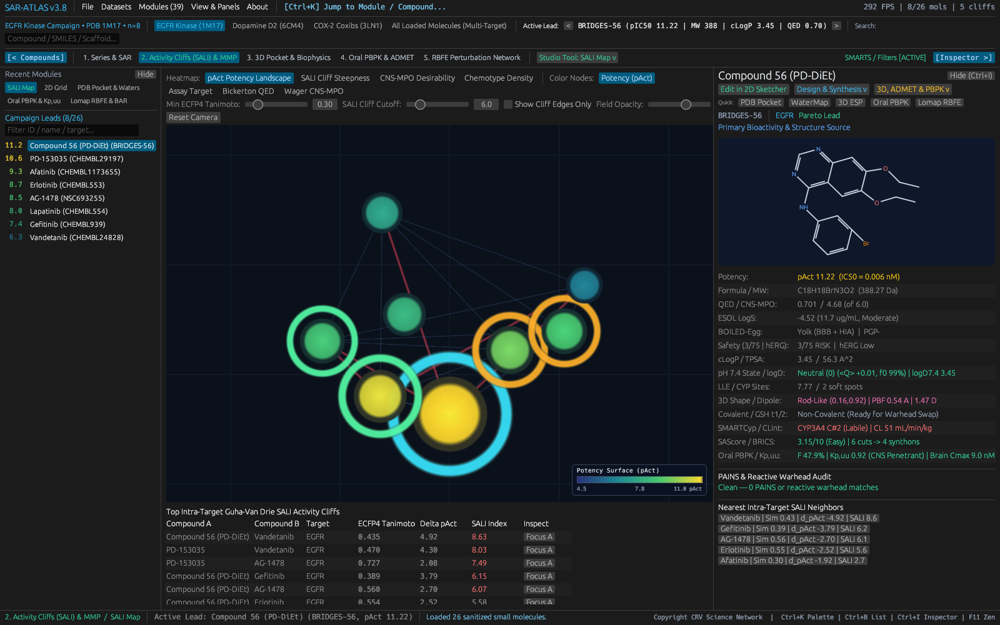

# SAR-Atlas (`v3.8.0`)



**SAR-Atlas (`v3.8.0`)** is a standalone, pure-Rust small-molecule, fragment-to-lead, macrocyclic, `PROTAC`, metabolic (`SMARTCyp`), prodrug, physiologically based pharmacokinetic (`PBPK`), and candidate-nomination cheminformatics workbench uniting [multi-parameter optimization (`MPO`) desirability](https://pubmed.ncbi.nlm.nih.gov/22316157/) ([Segall 2014](https://pubmed.ncbi.nlm.nih.gov/24793080/), [Derringer & Suich desirability](https://pmc.ncbi.nlm.nih.gov/articles/PMC6217265/), [AstraZeneca `5R` candidate governance](https://pubmed.ncbi.nlm.nih.gov/24833294/) / [Morgan et al. 2018](https://pubmed.ncbi.nlm.nih.gov/29348681/)) and standalone `.html` / `.svg` medicinal-chemistry dossier export with [7-segment `CAT`/`ACAT` oral absorption](https://pubmed.ncbi.nlm.nih.gov/10486429/) ([Yu & Amidon `ACAT`](https://pmc.ncbi.nlm.nih.gov/articles/PMC2691458/)), [`Q_gut` enterocyte](https://pmc.ncbi.nlm.nih.gov/articles/PMC5412686/) & [Pang-Rowland well-stirred hepatic first-pass clearance (`Fa * Fg * Fh`)](https://pubmed.ncbi.nlm.nih.gov/599411/), [Rodgers & Rowland (2006) tissue-composition `Vss`](https://pubmed.ncbi.nlm.nih.gov/16639716/), [Hammarlund-Udenaes & Fridén unbound brain `Kp,uu,brain` `RK4` curves](https://pubmed.ncbi.nlm.nih.gov/18058202/) ([Loryan & Di 2022](https://pmc.ncbi.nlm.nih.gov/articles/PMC9246790/), [physics-based `Kp,uu,brain`](https://pmc.ncbi.nlm.nih.gov/articles/PMC10828645/)), [bioreversible prodrug promoiety design (`ester`, `phosphate`, `carbamate`, `oxazolidinone` & `hPEPT1`)](https://pubmed.ncbi.nlm.nih.gov/29700501/) ([Rautio 2008](https://pubmed.ncbi.nlm.nih.gov/18219308/), [`CES1`/`CES2`](https://pmc.ncbi.nlm.nih.gov/articles/PMC6146386/) / [Di 2019](https://pmc.ncbi.nlm.nih.gov/articles/PMC6635651/), [`ALP` phosphates](https://pubmed.ncbi.nlm.nih.gov/19372225/) / [Wiemer 2016](https://pmc.ncbi.nlm.nih.gov/articles/PMC4774048/), [Simplício amines](https://pmc.ncbi.nlm.nih.gov/articles/PMC6245426/), [carbamates](https://pmc.ncbi.nlm.nih.gov/articles/PMC7968508/), [oxazolidinones](https://pubmed.ncbi.nlm.nih.gov/7562932/)), [`Rule-of-3` fragment growing](https://pubmed.ncbi.nlm.nih.gov/14554012/) ([Jhoti 2013](https://pubmed.ncbi.nlm.nih.gov/23845999/), [Astex sociability](https://pmc.ncbi.nlm.nih.gov/articles/PMC8130625/), [deconstruction](https://pmc.ncbi.nlm.nih.gov/articles/PMC12169673/), [`GE`](https://pubmed.ncbi.nlm.nih.gov/18651625/)/[`LE`](https://pubmed.ncbi.nlm.nih.gov/15109945/)/[`LLE`](https://pubmed.ncbi.nlm.nih.gov/17971784/)/[`SILE`](https://pmc.ncbi.nlm.nih.gov/articles/PMC6755556/)), [`RCM`/lactam macrocyclization](https://pmc.ncbi.nlm.nih.gov/articles/PMC4374646/) ([Giordanetto & Kihlberg](https://pubmed.ncbi.nlm.nih.gov/24044773/), [Kihlberg 2023](https://pmc.ncbi.nlm.nih.gov/articles/PMC10150360/), [`lorlatinib`](https://pubmed.ncbi.nlm.nih.gov/24819116/), [`-T * Delta S_conf`](https://pmc.ncbi.nlm.nih.gov/articles/PMC10880908/), [Kier `Phi`](https://pmc.ncbi.nlm.nih.gov/articles/PMC10425998/)), [`SMARTCyp` metabolism](https://pmc.ncbi.nlm.nih.gov/articles/PMC4055970/) ([`BioTransformer`](https://pmc.ncbi.nlm.nih.gov/articles/PMC6689873/)), [`PROTAC` `bRo5`](https://pmc.ncbi.nlm.nih.gov/articles/PMC9400730/) ([`dIMHB`](https://pmc.ncbi.nlm.nih.gov/articles/PMC11542721/), [`AB-MPS`](https://pubmed.ncbi.nlm.nih.gov/28926247/), [Hook-Effect](https://pmc.ncbi.nlm.nih.gov/articles/PMC3717292/)), covalent [`GSH` tuning](https://pubmed.ncbi.nlm.nih.gov/25375838/) & [cyanoacrylamides](https://pmc.ncbi.nlm.nih.gov/articles/PMC3657615/), [`ETKDG`](https://pubmed.ncbi.nlm.nih.gov/26575315/) / [`MMFF-lite`](https://pmc.ncbi.nlm.nih.gov/articles/PMC4026342/) / [`USR`](https://pubmed.ncbi.nlm.nih.gov/17342716/) / [`ROCS`](https://pubmed.ncbi.nlm.nih.gov/17201411/), micro-`pKa` ([Dimorphite-DL](https://www.semanticscholar.org/paper/Dimorphite-DL%3A-an-open-source-program-for-the-of-Ropp-Kaminsky/f19c60c3ce9c286610e99ac367c4f6fc496b1181)), [McGregor](https://www.semanticscholar.org/paper/Backtrack-search-algorithms-and-the-maximal-common-McGregor/ed10c6f788922cd5e7cb26c3d55f676979958852)/[`VF2`](https://pmc.ncbi.nlm.nih.gov/articles/PMC3633016/) `MCS`, [`BRICS`](https://pubmed.ncbi.nlm.nih.gov/18792903/), [`SAScore`](https://pmc.ncbi.nlm.nih.gov/articles/PMC3225829/), [Gobbi pharmacophores](https://pubmed.ncbi.nlm.nih.gov/10099495/), `ADMET` ([`ESOL`](https://pubmed.ncbi.nlm.nih.gov/15154768/) & [`BOILED-Egg`](https://pubmed.ncbi.nlm.nih.gov/27218427/)), [Meanwell bioisosteres](https://pubmed.ncbi.nlm.nih.gov/21413808/), [ChEMBL](https://chembl.gitbook.io/chembl-interface-documentation/web-services/chembl-data-web-services)/[PubChem](https://academic.oup.com/nar/article/46/W1/W563/4990016), and `SQLite 3` across a [`wgpu`](https://github.com/gfx-rs/wgpu) + [`egui`](https://github.com/emilk/egui) 5-domain (`39`-module + `Ctrl+K` command-palette) desktop studio, zero-dependency 23-view native ANSI terminal console, and `Clap` CLI.

## Workspace Architecture

- **`crates/sar-core`** — Pure-Rust parallel 2D/3D cheminformatics, cross-module `Derringer-Suich` lead scorecards & `.html`/`.svg` candidate dossiers, `RK4` oral `PBPK` & `Kp,uu,brain`, prodrug bioconversion, `FBDD` `Rule-of-3` growing, `RCM`/lactam macrocyclization, `SMARTCyp` metabolism, `PROTAC` `bRo5`, covalent reactivity, `MMFF-lite`, `ROCS`, micro-`pKa`, MCS, retrosynthesis, pharmacophore, ADMET & persistence engine ([`Rayon`](https://github.com/rayon-rs/rayon), [`ureq`](https://docs.rs/ureq/2.9.1/x86_64-unknown-linux-gnu/ureq/index.html) & bundled [`rusqlite`](https://docs.rs/rusqlite/latest/src/rusqlite/lib.rs.html)):
  - `electrostatics_esp.rs` (**New in v3.8.0**): 3D Connolly surface molecular electrostatic potential (`ESP`) mapper, `XED`-style off-nucleus multipole engine, and directional noncovalent scanner uniting [`Bauer & Mackey (2019)` `EC` / `EC_r` / `EC_rho` interfacial electrostatic complementarity](https://pubmed.ncbi.nlm.nih.gov/30807144/) ([`Milanetti et al. 2023`](https://pmc.ncbi.nlm.nih.gov/articles/PMC10290103/)), [`Cavallo, Metrangolo & Resnati et al. (2016)` anisotropic `C-X...B` `sigma-hole` halogen bonding (`Cl < Br < I`)](https://pmc.ncbi.nlm.nih.gov/articles/PMC4768247/) ([`Kohn-Sham MO/EDA halogen-bond analysis`](https://pmc.ncbi.nlm.nih.gov/articles/PMC7093837/)), and [`Adhav et al. (2023)` bivalent sulfur `sigma*` chalcogen bonds & `1,5` `S...O=C` thiazole conformational locks](https://pmc.ncbi.nlm.nih.gov/articles/PMC10411326/) with [`Wheeler-Houk` substituent-tuned `pi-pi` local dipole models](https://pmc.ncbi.nlm.nih.gov/articles/PMC5907483/) ([`slip-stacked dispersion/quadrupole geometry`](https://pmc.ncbi.nlm.nih.gov/articles/PMC8159364/)) and [`Gallivan-Dougherty` `cation-pi` recognition](https://pmc.ncbi.nlm.nih.gov/articles/PMC8338773/).
  - `public_pdb_fetch.rs`: Standalone open-public structure & confidence fetcher querying [`RCSB Protein Data Bank` Data & Chemical Component Dictionary REST APIs](https://pmc.ncbi.nlm.nih.gov/articles/PMC12807596/) ([`CSM/pLDDT` search architecture](https://pmc.ncbi.nlm.nih.gov/articles/PMC11514064/)) and [`EMBL-EBI AlphaFold Protein Structure Database` (`AFDB`) `UniProt` coordinate + `PAE` endpoints](https://pmc.ncbi.nlm.nih.gov/articles/PMC8728224/) ([`AFDB 2025`](https://pmc.ncbi.nlm.nih.gov/articles/PMC12807749/)), parsing 4-band per-residue `pLDDT` ([`Jumper et al. 2021`](https://pmc.ncbi.nlm.nih.gov/articles/PMC8371605/)) and crystallographic `B-factor` `RMSF`, 2D `PAE` domain rigidity matrices, `apo`-like inward side-chain `chi1` occluders ([`Karelina, Noh & Dror 2023 PNAS`](https://pmc.ncbi.nlm.nih.gov/articles/PMC10746139/)), disordered loop trimming, co-crystal ligand `SMILES` extraction, and 1-click `.pdb` handoff into `Pocket`, `WaterMap`, `H-Bond`, `Induced-Fit`, `3D Sculpt`, and `DMTA Funnel`.
  - `foldit_sculpt.rs`: Interactive 3D tactile ligand & side-chain force-field sculptor, harmonic rubber-band H-bond restraint engine, and timed med-chem challenge puzzle suite uniting [`Cooper et al. (2010)` `Foldit` direct 3D pulling, rubber-band springs, atom freezing, repulsion dialing, `Shake` & `Wiggle`](https://pmc.ncbi.nlm.nih.gov/articles/PMC2956414/), [`Khatib et al. (2011)` player-discovered `Blue-Fuse` barrier-crossing protocols](https://pmc.ncbi.nlm.nih.gov/articles/PMC3705907/), and [`Kleffner et al. (2017)` `Foldit Standalone` real-time modeling](https://pmc.ncbi.nlm.nih.gov/articles/PMC5860063/) with [`Drugit` (2025) small-molecule `VHL` (`5NVX`) `cart_bonded` strain & `TPSA`/`HBD`/`cLogP` puzzle design](https://pmc.ncbi.nlm.nih.gov/articles/PMC11997059/) and [`Croll (2018)` `ISOLDE` interactive mouse-tugged nonbonded restraint minimization](https://pmc.ncbi.nlm.nih.gov/articles/PMC6096486/), featuring 60-FPS 3D atom tugging, in-pocket R-group sprouting, Bronze/Silver/Gold/Platinum medal tiers, and `.pdb`/`.sdf`/`.csv` export.
  - `watermap_solvation.rs`: Active-site Inhomogeneous Fluid Solvation Theory (`IFST` / `WaterMap` / `GIST`) `dH` / `-TdS` / `dG` hydration-site hotspot mapper and displaceable-water R-group vector designer uniting [`Young, Abel, Kim, Berne & Friesner (2007)` `1.0 A` Quality-Threshold hydration spheres & hydrophobic-enclosure dewetting](https://pmc.ncbi.nlm.nih.gov/articles/PMC1783395/) and [`Abel, Young, Farid, Berne & Friesner (2008)` `WaterMap` excess enthalpy/entropy decomposition on Coagulation Factor Xa (`1EZQ`)](https://pmc.ncbi.nlm.nih.gov/articles/PMC2761766/) with [`Nguyen, Kurtzman Young & Gilson (2012)` 3D `GIST` Cartesian voxel solvation fields](https://pmc.ncbi.nlm.nih.gov/articles/PMC3416872/), [`Nguyen, Cruz, Gilson & Kurtzman (2014)` capped single-site overlap scoring](https://pmc.ncbi.nlm.nih.gov/articles/PMC4089914/), and [`Huggins (2015)` cavity water correlation entropies](https://pmc.ncbi.nlm.nih.gov/articles/PMC4336375/) / [`Barillari et al. (2007)` structural vs displaceable water thermodynamics](https://pubmed.ncbi.nlm.nih.gov/17288418/), paired with 14-warhead exit-vector R-group enumeration (`-Cl`, `-CN`, `-CF3`, `-CHF2`, `-CH3`, `-OH`, `-CH2OH`, `-cPr`) and `WME`/`WMS`/`WMD`/`WMB` `.pdb` export.
  - `hbond_network.rs`: Active-site `His` (`HID`/`HIE`/`HIP`), `Asp`/`Glu` (`ASH`/`GLH`), `Asn`/`Gln` `180 deg` amide-flip, and crystallographic bridge-water hydrogen-bond network optimizer uniting [`Bietz, Urbaczek, Schulz & Rarey (2014)` `Protoss` coupled protein-ligand tautomer/protonation assignment](https://pmc.ncbi.nlm.nih.gov/articles/PMC4019353/) and [`Sastry & Sherman (2013)` `ProtAssign` active-site preparation](https://pubmed.ncbi.nlm.nih.gov/23579614/) with [`Word et al. (1999)` `Reduce` `180 deg` `Asn`/`Gln`/`His` flip resolution](https://pubmed.ncbi.nlm.nih.gov/9917408/) ([`NQ-Flipper`](https://academic.oup.com/bioinformatics/article/22/11/1397/239014)), [`Søndergaard et al. (2011)` `PROPKA 3.1` coupled micro-`pKa` shifts](https://pubmed.ncbi.nlm.nih.gov/26606496/), and [`Barillari et al. (2007)` conserved vs displaced binding-site water thermodynamics](https://pubmed.ncbi.nlm.nih.gov/17288418/) / [`Ross, Morris & Biggin (2012)` `WaterDock` bridging water scoring](https://pmc.ncbi.nlm.nih.gov/articles/PMC3291545/), solved via Goldstein Dead-End Elimination + exact Branch-and-Bound with Wyman proton-linked `dG_HBN(pH)` profiling and prepared `.pdb` export.
  - `induced_fit.rs`: Flexible binding-pocket side-chain rotamer repacker and 5-state receptor-ensemble Boltzmann scorer uniting [`Sherman et al. (2006)` Induced-Fit Docking (`IFDScore`)](https://pubmed.ncbi.nlm.nih.gov/16420040/) ([large conformational shifts in `IFD`](https://pmc.ncbi.nlm.nih.gov/articles/PMC11513859/)) and [`AutoDockFR` explicit binding-site side-chain flexibility](https://pmc.ncbi.nlm.nih.gov/articles/PMC4667975/) with [`Shapovalov & Dunbrack (2011)` smoothed `chi1`/`chi2` rotamer libraries](https://pmc.ncbi.nlm.nih.gov/articles/PMC3118414/) ([fast side-chain packing](https://pmc.ncbi.nlm.nih.gov/articles/PMC7938712/)), [`Fischer, Coleman, Fraser & Shoichet (2014)` receptor reorganization energy penalties (`dG_reorg = -RT ln(w_k / w_0)`)](https://pmc.ncbi.nlm.nih.gov/articles/PMC4144196/) ([energy penalties in flexible cavity docking](https://pmc.ncbi.nlm.nih.gov/articles/PMC8433570/)), and [`Amaro et al. (2018)` ensemble docking](https://pmc.ncbi.nlm.nih.gov/articles/PMC6129458/) / [`Totrov & Abagyan (2008)` multiple receptor conformations (`MRC`)](https://pmc.ncbi.nlm.nih.gov/articles/PMC2396190/) partition-function scoring (`dG_Boltzmann`, `KL` apo-to-holo state shift, & induced-fit clash rescue).
  - `fragment_linker.rs`: Sub-pocket fragment-pair 3D exit-vector aligner implementing [`DeLinker` 4-DOF `(d_anchor, alpha_A, alpha_B, dihedral_phi)` parameterization](https://pmc.ncbi.nlm.nih.gov/articles/PMC7189367/) ([`DEVELOP` pharmacophoric linker design](https://pmc.ncbi.nlm.nih.gov/articles/PMC8580048/), [`AIMLinker` 3D anchor angle/distance matching](https://pmc.ncbi.nlm.nih.gov/articles/PMC10207268/), [`Fragmenstein` 3D fragment merging & linking](https://pmc.ncbi.nlm.nih.gov/articles/PMC11731148/)), `18`-scaffold direct-bond, amide/sulfonamide, linear alkyne, `CuAAC` `1,4`-triazole, `1,3,4`-oxadiazole, `1,3`-azetidine, `1,3-BCP`, and `2-azaspiro[3.3]heptane` geometry matching, simultaneous dual-core Kabsch `RMSD_Fragments` pose-preservation scoring, and the full [`Murray & Verdonk (2002)` translational/rotational rigid-body entropy (`15-20 kJ/mol` / `4.20 kcal/mol`) super-additivity thermodynamic cycle](https://pubmed.ncbi.nlm.nih.gov/12650591/) ([protein-templated super-additive fragment ligations](https://pmc.ncbi.nlm.nih.gov/articles/PMC7159684/), [dual-site `dG_link` deconstruction](https://pmc.ncbi.nlm.nih.gov/articles/PMC11997991/), [bivalent ATP-allosteric kinase linking](https://pmc.ncbi.nlm.nih.gov/articles/PMC10879502/), & [`Ichihara et al. (2011)` fragment-linking coefficient `E_link`](https://pubmed.ncbi.nlm.nih.gov/27466947/) / [NMR growing-merging-linking](https://pmc.ncbi.nlm.nih.gov/articles/PMC3699969/)).
  - `discovery_pipeline.rs`: Closed-loop multi-round (`1..5` iterative `DMTA` cycles), custom target/off-target `.pdb`-capable Configurable 6-stage [hierarchical virtual-screening & lead-optimization cascade](https://pmc.ncbi.nlm.nih.gov/articles/PMC7129923/) ([scaffold-aware ML + docking cascades](https://pmc.ncbi.nlm.nih.gov/articles/PMC13292220/)) uniting [multi-objective generative `DMTA` cycles](https://pmc.ncbi.nlm.nih.gov/articles/PMC13538683/) ([automated `DMTA` workflows](https://pmc.ncbi.nlm.nih.gov/articles/PMC7805875/)) across Stage 1 multi-stream intake (`DeNovo-GA`, `DEL`/parallel plates, `Meanwell` bioisosteres, `CSD` rotor locks), Stage 2 `PAINS`/`QED`/`ESOL`/`SAScore` triage, Stage 3 3D `PDB` pocket & [`Shoichet` `TEU` strain filtering](https://pubmed.ncbi.nlm.nih.gov/34467754/), Stage 4 dual-pocket paralog/mutant selectivity, Stage 5 [`MolPAL` `GP+RF` active-learning `EI`](https://pmc.ncbi.nlm.nih.gov/articles/PMC8188596/), and Stage 6 [cascading `Lomap` `BAR`/`MLE` `RBFE` ranking](https://pmc.ncbi.nlm.nih.gov/articles/PMC12381238/) with toggleable `FBDD` fragment-growing, macrocyclization, `pH 7.4` `pKa`, covalent `GSH`, and `GNM`/`ANM` allosteric branches, [`Bemis-Murcko` scaffold-diversity](https://pubmed.ncbi.nlm.nih.gov/8709122/) + [`MaxMin` `ECFP4` caps](https://pmc.ncbi.nlm.nih.gov/articles/PMC8067665/), non-blocking async GUI progress, `.json` workflow recipes, and `SQLite 3` `pipeline_runs` ledgers.
  - `torsion_strain.rs`: Hierarchical 22-rule [`CSD`/`SMARTS` Torsion Library scanner](https://pmc.ncbi.nlm.nih.gov/articles/PMC12728936/) ([`TABS`/`ETKDGv3` torsion hierarchy](https://pmc.ncbi.nlm.nih.gov/articles/PMC11523068/), [`TorsionChecker` pose rationality](https://pmc.ncbi.nlm.nih.gov/articles/PMC9632257/), [`CONFORGE` torsion driving](https://pmc.ncbi.nlm.nih.gov/articles/PMC10498443/)) executing `36`-bin (`0..360 deg`) 3D Rodrigues dihedral energy & entropy scans, [`Gu & Shoichet (2021)` Boltzmann `Torsion Energy Unit` (`TEU`) bioactive strain filtering](https://pubmed.ncbi.nlm.nih.gov/34467754/) ([`1.8 TEU` single-bond & `6.0 TEU` total-strain thresholds](https://pmc.ncbi.nlm.nih.gov/articles/PMC8501943/)) paired with [`Perola & Charifson (2004)` protein-bound reorganization benchmarks](https://pubmed.ncbi.nlm.nih.gov/15115393/) ([bound conformer diversity](https://pmc.ncbi.nlm.nih.gov/articles/PMC5880911/)), and automated rotatable-bond locking via [`ortho`-methyl steric gearing](https://pmc.ncbi.nlm.nih.gov/articles/PMC10457765/), [`Kuhn, Mohr & Stahl (2010)` `1,5`/`1,6` intramolecular H-bond (`IMHB`) pseudo-rings](https://pubmed.ncbi.nlm.nih.gov/20175530/) ([`IMHB` expectations](https://pmc.ncbi.nlm.nih.gov/articles/PMC5304308/)), `alpha`-methyl/`F`-gauche bias, and small-ring covalent cyclizations.
  - `rbfe_network.rs`: [`Lomap` (`Lead Optimization Mapper`) `MCS` alchemical perturbation-graph builder](https://pmc.ncbi.nlm.nih.gov/articles/PMC3837551/) enforcing [`MCSR`/`MNAR`/formal-charge & ring-breaking conservation rules](https://pmc.ncbi.nlm.nih.gov/articles/PMC4489933/) ([`OpenFE`/`Lomap` benchmark](https://pmc.ncbi.nlm.nih.gov/articles/PMC13555741/)), stratified multi-`lambda` 2-leg (`Complex` vs `Solvent`) [`FEP+`-style congeneric `RBFE` sampler](https://pubmed.ncbi.nlm.nih.gov/25625324/) uniting `Zwanzig` forward/reverse exponential averaging with self-consistent [`Bennett Acceptance Ratio` (`BAR`) & phase-space overlap `O_AB` diagnostics](https://pmc.ncbi.nlm.nih.gov/articles/PMC8388617/) ([`BAR`/`MBAR` best practices](https://pmc.ncbi.nlm.nih.gov/articles/PMC9842838/)), closed `3`- and `4`-membered thermodynamic [cycle-closure hysteresis auditing](https://pmc.ncbi.nlm.nih.gov/articles/PMC7137390/), and variance-weighted Graph-Laplacian [`BARnet`](https://pmc.ncbi.nlm.nih.gov/articles/PMC8011336/) / [`cinnabar` Maximum-Likelihood (`MLE`) node affinity reconciliation](https://pmc.ncbi.nlm.nih.gov/articles/PMC13080961/).
  - `active_learning.rs`: Positive-definite [`ECFP4` Tanimoto + `3D-USRCAT` hybrid-kernel](https://pubmed.ncbi.nlm.nih.gov/16157471/) ([`GAUCHE` Tanimoto `GP`](https://pmc.ncbi.nlm.nih.gov/articles/PMC13439769/), [Tanimoto `GP` chemoinformatics](https://academic.oup.com/biometrics/article/82/4/ujag168/8894036)) exact Cholesky Gaussian-Process (`GP`) and `24`-tree bootstrapped `Random Forest` ensemble QSAR surrogate with [epistemic uncertainty quantification](https://pubmed.ncbi.nlm.nih.gov/32702986/) ([post-hoc conformal calibration](https://pmc.ncbi.nlm.nih.gov/articles/PMC9898940/), [`UNIQUE` benchmarking](https://pmc.ncbi.nlm.nih.gov/articles/PMC12848971/)), [`MolPAL` Expected Improvement (`EI`) & Upper Confidence Bound (`UCB`)](https://pmc.ncbi.nlm.nih.gov/articles/PMC8188596/) ([accessible active learning](https://pmc.ncbi.nlm.nih.gov/articles/PMC11005039/), [`ChemScreener`](https://pmc.ncbi.nlm.nih.gov/articles/PMC13235147/)), and Kriging-Believer diversity-aware batch acquisition.
  - `allosteric_pocket.rs`: [`iGNM 2.0` Gaussian Network Model (`GNM`)](https://pmc.ncbi.nlm.nih.gov/articles/PMC4702874/) and [`ANM 2.0` `3N x 3N` Anisotropic Elastic Network (`ANM`)](https://pmc.ncbi.nlm.nih.gov/articles/PMC4410662/) ([unified `G-ANM`](https://pmc.ncbi.nlm.nih.gov/articles/PMC2367184/)) normal-mode eigensolver, [`PocketMiner`](https://pmc.ncbi.nlm.nih.gov/articles/PMC9977097/) / [`CryptoSite`](https://pmc.ncbi.nlm.nih.gov/articles/PMC12342141/)-inspired pocket-breathing cryptic cavity detector, [Dijkstra mutual-information allosteric pathway tracer](https://academic.oup.com/bioinformatics/article/38/14/3590/6604266) ([`PRS` dynamical couplings](https://academic.oup.com/bioinformatics/article/35/23/4971/5481959/)), and [`AlloSigMA` (`SBSMMA`)](https://pmc.ncbi.nlm.nih.gov/articles/PMC8772014/) + [kinase double-drugging cooperativity (`MWC` `alpha`)](https://pmc.ncbi.nlm.nih.gov/articles/PMC10450579/) allosteric-to-orthosteric mechanical strain profiler across [`5D41` EGFR αC-out](https://www.rcsb.org/structure/5d41) ([EAI045](https://pmc.ncbi.nlm.nih.gov/articles/PMC5542946/)), [`6OIM` KRAS G12C Switch-II](https://pmc.ncbi.nlm.nih.gov/articles/PMC10015465/), and [`3K5V` ABL1 myristoyl](https://pmc.ncbi.nlm.nih.gov/articles/PMC10450579/) systems.
  - `selectivity_screen.rs`: Dual-pocket target vs off-target [structure-based selectivity](https://pubmed.ncbi.nlm.nih.gov/22239221/) ([Huggins, Sherman & Tidor 2012](https://pmc.ncbi.nlm.nih.gov/articles/PMC3285144/)) and [differential `WaterMap` hydration hotspot analyzer](https://pmc.ncbi.nlm.nih.gov/articles/PMC8529594/) paired with [`mCSM-lig`](https://pubmed.ncbi.nlm.nih.gov/27384129/) ([PMC4935856](https://pmc.ncbi.nlm.nih.gov/articles/PMC4935856/)) / [`PremPLI`](https://pubmed.ncbi.nlm.nih.gov/34799678/) ([PMC8604987](https://pmc.ncbi.nlm.nih.gov/articles/PMC8604987/), [resistance `ddG` benchmarks](https://pmc.ncbi.nlm.nih.gov/articles/PMC12874888/)) single-point binding-pocket residue-mutation `Delta-Delta G` (`ddG_bind`) scanning across curated benchmark pairs ([`3LN1` COX-2](https://www.rcsb.org/structure/3ln1) vs [`3KK6` COX-1](https://www.rcsb.org/structure/3kk6) [`Val523/Ile523`](https://pmc.ncbi.nlm.nih.gov/articles/PMC2851773/), [`1M17` EGFR WT](https://www.rcsb.org/structure/1m17) vs [`2JIT` EGFR `T790M`](https://www.rcsb.org/structure/2jit) / [`3UG2`](https://www.rcsb.org/structure/3ug2) [gatekeeper resistance](https://pmc.ncbi.nlm.nih.gov/articles/PMC2538882/), and [`6CM4` DRD2](https://www.rcsb.org/structure/6cm4) vs [`3PBL` DRD3](https://www.rcsb.org/structure/3pbl)).
  - `parallel_lib.rs`: Split-and-pool [DNA-encoded chemical library (`DEL`)](https://pubmed.ncbi.nlm.nih.gov/19648931/) ([Goodnow, Dumelin & Keefe 2017](https://pubmed.ncbi.nlm.nih.gov/27932801/), [on-DNA reactions & 3-codon barcode tags](https://pmc.ncbi.nlm.nih.gov/articles/PMC8369695/), [focused 3-cycle `DEL` design](https://pmc.ncbi.nlm.nih.gov/articles/PMC7070942/), [`DEL` chemistry evolution](https://pmc.ncbi.nlm.nih.gov/articles/PMC10840438/)) and 96-well [medicinal-chemistry parallel library enumerator](https://pubmed.ncbi.nlm.nih.gov/21504168/) ([`C(sp2)-C(sp3)` parallel synthesis](https://pmc.ncbi.nlm.nih.gov/articles/PMC7153271/)) executing 2- and 3-step orthogonal `Amide` (`DMTMM`/`HATU`), `Suzuki-Miyaura` (`Pd`/`sSPhos`), `Buchwald-Hartwig` / `SNAr`, and regioselective `CuAAC` `1,4`-triazole click cascades with [`MaxMin` `ECFP4` sphere-exclusion diversity selection](https://pmc.ncbi.nlm.nih.gov/articles/PMC8067665/) ([make-on-demand library triage](https://pmc.ncbi.nlm.nih.gov/articles/PMC10752525/)) and 3D `PDB Pocket` / `ROCS` pre-filtering.
  - `pocket_cavity.rs`: Structure-based `.pdb` binding-site parser, [`fpocket`](https://pubmed.ncbi.nlm.nih.gov/19486540/) ([PMC2700099](https://pmc.ncbi.nlm.nih.gov/articles/PMC2700099/)) buried-cavity & `DScore` druggability mapper, [`WaterMap`-style active-site hydration enthalpy-entropy profiler](https://pubmed.ncbi.nlm.nih.gov/18266362/) ([PMC2761766](https://pmc.ncbi.nlm.nih.gov/articles/PMC2761766/), [`AutoDock-GIST`](https://pmc.ncbi.nlm.nih.gov/articles/PMC6274120/)) distinguishing high-energy displaceable waters from conserved structural H-bond bridges, [`LigandScout` 3D receptor pharmacophore extractor](https://pubmed.ncbi.nlm.nih.gov/15667141/) ([receptor pharmacophores](https://pmc.ncbi.nlm.nih.gov/articles/PMC6305075/)), and [`AutoDock Vina`-style empirical pocket complementarity scorer](https://pubmed.ncbi.nlm.nih.gov/19499576/) ([PMC3041641](https://pmc.ncbi.nlm.nih.gov/articles/PMC3041641/)) with built-in co-crystal complexes ([`1M17` EGFR](https://www.rcsb.org/structure/1m17), [`6CM4` DRD2](https://www.rcsb.org/structure/6cm4), [`3LN1` COX-2](https://www.rcsb.org/structure/3ln1)).
  - `de_novo_gen.rs`: Evolutionary de novo molecule generator uniting [Jensen (2019) graph-based genetic mutations (`GB-GA`)](https://pubmed.ncbi.nlm.nih.gov/30996948/) ([PMC6438151](https://pmc.ncbi.nlm.nih.gov/articles/PMC6438151/)), [Polishchuk (2020) chemically reasonable mutations (`CReM`)](https://pubmed.ncbi.nlm.nih.gov/33430959/) ([PMC7178718](https://pmc.ncbi.nlm.nih.gov/articles/PMC7178718/)), [Böhm et al. (2004) ring-hop bioisosteres](https://pubmed.ncbi.nlm.nih.gov/24981488/) with [Lovering `Escape-from-Flatland` `BCP`/spiro `sp3` cages](https://pubmed.ncbi.nlm.nih.gov/19827778/), and [Spiegel & Durrant (2020) `AutoGrow4`](https://pubmed.ncbi.nlm.nih.gov/33431021/) ([PMC7165399](https://pmc.ncbi.nlm.nih.gov/articles/PMC7165399/)) [`BRICS` synthon crossovers](https://pubmed.ncbi.nlm.nih.gov/18792903/), guided across [GuacaMol-style multi-objective benchmarks](https://pubmed.ncbi.nlm.nih.gov/30887799/) by 3D [`ROCS`](https://pubmed.ncbi.nlm.nih.gov/17201411/)/[`USRCAT`](https://pmc.ncbi.nlm.nih.gov/articles/PMC3505738/) shape-color superposition, 2D [Gobbi pharmacophores](https://pubmed.ncbi.nlm.nih.gov/10099495/), [`LE`](https://pubmed.ncbi.nlm.nih.gov/15109945/)/[`LLE`](https://pubmed.ncbi.nlm.nih.gov/17971784/), and [Ertl `SAScore`](https://pmc.ncbi.nlm.nih.gov/articles/PMC3225829/).
  - `campaign_report.rs`: Cross-module medicinal-chemistry lead scorecard and zero-dependency `.html` / `.svg` dossier exporter implementing [Segall (2012) multi-parameter optimization](https://pubmed.ncbi.nlm.nih.gov/22316157/) ([Segall 2014](https://pubmed.ncbi.nlm.nih.gov/24793080/)), [Derringer & Suich geometric desirability](https://pmc.ncbi.nlm.nih.gov/articles/PMC6217265/) ([DOM](https://pmc.ncbi.nlm.nih.gov/articles/PMC5650527/)), and [AstraZeneca `5R` candidate nomination stage-gates](https://pubmed.ncbi.nlm.nih.gov/24833294/) ([Morgan et al. 2018](https://pubmed.ncbi.nlm.nih.gov/29348681/)) across 4 selectable Target Product Profiles (`Oral Peripheral`, `Oral CNS BBB`, `Targeted Covalent TCI`, and `bRo5 / Prodrug-Rescued`), 6 normalized desirability radar pillars, 12 explicit Stage-Gate thresholds, scaffold-diversified backup selection, next-DMTA-cycle structural proposals, and print-ready standalone `.html` + multi-panel `.svg` export.
  - `pbpk_oral.rs`, `prodrug.rs`, `fragment_grower.rs`, `macrocycle.rs`, `cyp_metabolism.rs`, `protac_linker.rs` & `covalent_warhead.rs`: Mechanistic 20-state `RK4` human oral `PBPK` ([Yu & Amidon `CAT`/`ACAT`](https://pubmed.ncbi.nlm.nih.gov/10486429/), [`ACAT` review](https://pmc.ncbi.nlm.nih.gov/articles/PMC2691458/), [Yang `Q_gut` `Fg`](https://pmc.ncbi.nlm.nih.gov/articles/PMC5412686/), [gut-wall extraction](https://pmc.ncbi.nlm.nih.gov/articles/PMC4875961/), [Pang & Rowland `Fh`](https://pubmed.ncbi.nlm.nih.gov/599411/), [Rodgers & Rowland `Vss`](https://pubmed.ncbi.nlm.nih.gov/16639716/), [Hammarlund-Udenaes `Kp,uu,brain`](https://pubmed.ncbi.nlm.nih.gov/18058202/), [Loryan & Di 2022](https://pmc.ncbi.nlm.nih.gov/articles/PMC9246790/), [physics-based `Kp,uu`](https://pmc.ncbi.nlm.nih.gov/articles/PMC10828645/)), 20-promoiety [`BCS` prodrug designer](https://pubmed.ncbi.nlm.nih.gov/29700501/) ([Rautio 2008](https://pubmed.ncbi.nlm.nih.gov/18219308/), [`CES1`/`CES2`](https://pmc.ncbi.nlm.nih.gov/articles/PMC6146386/), [Di 2019](https://pmc.ncbi.nlm.nih.gov/articles/PMC6635651/), [`ALP`](https://pubmed.ncbi.nlm.nih.gov/19372225/), [Wiemer](https://pmc.ncbi.nlm.nih.gov/articles/PMC4774048/), [Simplício](https://pmc.ncbi.nlm.nih.gov/articles/PMC6245426/), [carbamates](https://pmc.ncbi.nlm.nih.gov/articles/PMC7968508/), [oxazolidinones](https://pubmed.ncbi.nlm.nih.gov/7562932/)), [`Rule-of-3`](https://pubmed.ncbi.nlm.nih.gov/14554012/) ([Jhoti 2013](https://pubmed.ncbi.nlm.nih.gov/23845999/), [Astex sociability](https://pmc.ncbi.nlm.nih.gov/articles/PMC8130625/), [deconstruction](https://pmc.ncbi.nlm.nih.gov/articles/PMC12169673/), [`GE`](https://pubmed.ncbi.nlm.nih.gov/18651625/)/[`LE`](https://pubmed.ncbi.nlm.nih.gov/15109945/)/[`LLE`](https://pubmed.ncbi.nlm.nih.gov/17971784/)/[`SILE`](https://pmc.ncbi.nlm.nih.gov/articles/PMC6755556/)), 10-tether [`RCM`/lactam macrocyclizer](https://pmc.ncbi.nlm.nih.gov/articles/PMC4374646/) ([`lorlatinib`](https://pubmed.ncbi.nlm.nih.gov/24819116/), [Kier `Phi`](https://pmc.ncbi.nlm.nih.gov/articles/PMC10425998/), [`-T * Delta S_conf`](https://pmc.ncbi.nlm.nih.gov/articles/PMC10880908/), [Giordanetto & Kihlberg](https://pubmed.ncbi.nlm.nih.gov/24044773/), [Kihlberg 2023](https://pmc.ncbi.nlm.nih.gov/articles/PMC10150360/)), [`SMARTCyp`](https://pmc.ncbi.nlm.nih.gov/articles/PMC4055970/) ([Server](https://pubmed.ncbi.nlm.nih.gov/20947523/), [`CYP2D6`](https://pmc.ncbi.nlm.nih.gov/articles/PMC4025842/)), [`BioTransformer`](https://pmc.ncbi.nlm.nih.gov/articles/PMC6689873/) ([`3.0`](https://pmc.ncbi.nlm.nih.gov/articles/PMC9252798/), [`GLORY`](https://pmc.ncbi.nlm.nih.gov/articles/PMC6582643/), [`MIST`](https://pmc.ncbi.nlm.nih.gov/articles/PMC8826528/)), `PROTAC` ([Troup](https://pmc.ncbi.nlm.nih.gov/articles/PMC9400730/), [Békés](https://pmc.ncbi.nlm.nih.gov/articles/PMC8765495/), [`AB-MPS`](https://pubmed.ncbi.nlm.nih.gov/28926247/), [`dIMHB`](https://pmc.ncbi.nlm.nih.gov/articles/PMC11542721/), [Folding](https://pmc.ncbi.nlm.nih.gov/articles/PMC9574858/), [Hook-Effect](https://pmc.ncbi.nlm.nih.gov/articles/PMC3717292/)), and covalent warheads ([Flanagan `GSH`](https://pubmed.ncbi.nlm.nih.gov/25375838/), [Tuning](https://pmc.ncbi.nlm.nih.gov/articles/PMC5308545/), [Fragments](https://pmc.ncbi.nlm.nih.gov/articles/PMC9694498/), [`k_inact/K_I`](https://pmc.ncbi.nlm.nih.gov/articles/PMC6538824/), [Boike](https://pmc.ncbi.nlm.nih.gov/articles/PMC9403961/), [Serafimova](https://pmc.ncbi.nlm.nih.gov/articles/PMC3657615/), [Miller](https://pubmed.ncbi.nlm.nih.gov/23540679/)).
  - `conformer3d.rs`, `pka_protomer.rs`, `mcs.rs`, `brics_reassemble.rs`, `synth_access.rs`, `pharmacophore.rs`, `chembl_ingest.rs`, `project_store.rs`, `admet.rs`, `bioisostere.rs`, `sketcher.rs`, `rgroup_table.rs`, `smarts.rs`, `mol.rs`, `mol_io.rs`, `layout2d.rs`, `physchem.rs`, `fingerprint.rs`, `scaffold.rs`, `mmp.rs` & `alerts.rs`: [`ETKDG`](https://pubmed.ncbi.nlm.nih.gov/26575315/), [`MMFF-lite`](https://pmc.ncbi.nlm.nih.gov/articles/PMC4026342/), [Gasteiger `PEOE`](https://pubs.acs.org/jcisd8/article/43/6/1982/3805393/Fast-Assignment-of-Accurate-Partial-Atomic-Charges), [Kabsch](https://pmc.ncbi.nlm.nih.gov/articles/PMC12951576/), [`USR`](https://pubmed.ncbi.nlm.nih.gov/17342716/), [`USRCAT`](https://pmc.ncbi.nlm.nih.gov/articles/PMC3505738/), [`ROCS`](https://pmc.ncbi.nlm.nih.gov/articles/PMC6068280/) ([Hawkins 2007](https://pubmed.ncbi.nlm.nih.gov/17201411/)), micro-`pKa` ([Milletti](https://pubmed.ncbi.nlm.nih.gov/17910431/), [Dimorphite-DL](https://www.semanticscholar.org/paper/Dimorphite-DL%3A-an-open-source-program-for-the-of-Ropp-Kaminsky/f19c60c3ce9c286610e99ac367c4f6fc496b1181), [Gypsum-DL](https://pmc.ncbi.nlm.nih.gov/articles/PMC6534830/)), [`MolVS`](https://pmc.ncbi.nlm.nih.gov/articles/PMC9148294/) ([Sitzmann](https://pubmed.ncbi.nlm.nih.gov/20512400/)), [McGregor](https://www.semanticscholar.org/paper/Backtrack-search-algorithms-and-the-maximal-common-McGregor/ed10c6f788922cd5e7cb26c3d55f676979958852), [`VF2`](https://pmc.ncbi.nlm.nih.gov/articles/PMC3633016/), [Raymond & Willett](https://pubmed.ncbi.nlm.nih.gov/12510884/), [`FMCS`](https://pmc.ncbi.nlm.nih.gov/articles/PMC3606201/), [Degen `BRICS`](https://pubmed.ncbi.nlm.nih.gov/18792903/) ([RDKit `BRICS`](https://pmc.ncbi.nlm.nih.gov/articles/PMC13392931/)), [Free-Wilson](https://pubmed.ncbi.nlm.nih.gov/14221113/) ([Ridge](https://www.mdpi.com/1420-3049/31/20/3775)), [`QED`](https://pubmed.ncbi.nlm.nih.gov/22270643/), [Ertl `SAScore`](https://pmc.ncbi.nlm.nih.gov/articles/PMC3225829/) ([`sascorer.py`](https://github.com/rdkit/rdkit/blob/master/Contrib/SA_Score/sascorer.py), [`RECAP`](https://pubmed.ncbi.nlm.nih.gov/9611787/)), [Gobbi](https://pubmed.ncbi.nlm.nih.gov/10099495/), [`CATS`](https://pubmed.ncbi.nlm.nih.gov/10540384/), [`CATS2`](https://pmc.ncbi.nlm.nih.gov/articles/PMC3743170/), [SwissSimilarity](https://pdfs.semanticscholar.org/67ea/4a92a16da11d44125e7ac25d291de87dd5d0.pdf), [ChEMBL](https://chembl.gitbook.io/chembl-interface-documentation/web-services/chembl-data-web-services), [PubChem](https://academic.oup.com/nar/article/46/W1/W563/4990016), [`ESOL`](https://pubmed.ncbi.nlm.nih.gov/15154768/), [`BOILED-Egg`](https://pubmed.ncbi.nlm.nih.gov/27218427/), [`3/75`](https://pmc.ncbi.nlm.nih.gov/articles/PMC8622797/), [Meanwell](https://pubmed.ncbi.nlm.nih.gov/21413808/), [Weininger `CANGEN`](https://pubs.acs.org/jcisd8/article/29/2/97/1079225/SMILES-2-Algorithm-for-generation-of-unique-SMILES) [OpenSMILES](http://opensmiles.org/opensmiles.html), [SMARTS](https://www.daylight.com/dayhtml/doc/theory/theory.smarts.html), [`cLogP`](https://www.researchgate.net/publication/237983873_Prediction_of_Physicochemical_Parameters_by_Atomic_Contributions), [`TPSA`](https://pubs.acs.org/jmcmar/article/43/20/3714/3556670/Fast-Calculation-of-Molecular-Polar-Surface-Area), [`CNS-MPO`](https://pmc.ncbi.nlm.nih.gov/articles/PMC3368654/), [`ECFP4`](https://pubmed.ncbi.nlm.nih.gov/20426451/), [`SALI`](https://pubmed.ncbi.nlm.nih.gov/18686944/), [Bemis-Murcko](https://pubmed.ncbi.nlm.nih.gov/8709122/), [`MMP`](https://pubmed.ncbi.nlm.nih.gov/20121245/), and [`PAINS`](https://pubmed.ncbi.nlm.nih.gov/20131845/).
- **`crates/sar-app`** — Unified binary (`sar-atlas`):
  - `gui.rs` & `wgpu_pass.rs`: [`egui`](https://github.com/emilk/egui) + [`egui_wgpu::CallbackTrait`](https://docs.rs/egui-wgpu/latest/egui_wgpu/trait.CallbackTrait.html) desktop workbench featuring a native top menu bar (`File`, `Datasets`, `Modules`, `View & Panels`), a single-row **5-Domain Navigation Ribbon** (`1. Landscape & SAR`, `2. Molecular Design`, `3. Synthesis, Data & Dossier`, `4. 3D & Reactivity`, `5. ADMET & PBPK` spanning all 39 modules including `Lead Dossier & HTML`), a `Ctrl+K` fuzzy module/compound command palette, collapsible Left Compound/MRU (`Ctrl+B`), Right Inspector (`Ctrl+I`), and SMARTS Filter (`Ctrl+F`) panels, and `F11` Zen full-canvas mode.
  - `tui.rs` & `main.rs`: Standalone 23-view pure-`std::io` ANSI terminal console (with one-key `h` HTML dossier export) + `Clap` v4 CLI (`gui`, `tui`, `esp`, `fetch-pdb`, `sculpt`, `watermap`, `hbond-net`, `induced-fit`, `frag-link`, `pipeline`, `torsion-strain`, `rbfe`, `active-learn`, `allosteric`, `selectivity`, `del-lib`, `pocket`, `de-novo`, `dossier`, `pbpk`, `prodrug`, `frag-grow`, `macrocycle`, `metabolism`, `protac`, `warheads`, `3d-overlay`, `pka`, `mcs`, `brics-recombine`, `retrosynth`, `pharmacophore`, `fetch-chembl`, `fetch-pubchem`, `save-project`, `inspect-project`, `sketch-eval`, `admet`, `bioisosteres`, `smarts`, `rgroup`, `analyze`, `cliffs`, `mmp`, `export-svg`, `export-sdf`, `bench`).

## Quick Start & CLI Usage

```bash
# Run offline unit and integration tests across all v3.8.0 modules
cargo test --workspace --release

# Launch the interactive v3.8.0 5-domain (39-module + Ctrl+K) egui + wgpu desktop workbench
cargo run --release

# Analyze VHL 5NVX 3D ESP complementarity, 1,5 thiazole S..O=C chalcogen lock, & bioisosteric designs and export XED multipole .pdb
cargo run --release -- esp --preset vhl --screen-dataset --export-contacts-csv vhl_esp_contacts.csv --export-designs-csv vhl_esp_designs.csv --export-pdb vhl_xed_multipoles.pdb

# Audit AlphaFold DB KRAS (UniProt P01116) per-residue pLDDT, PAE, & Karelina-Dror apo-occlusion readiness and export loop-trimmed .pdb
cargo run --release -- fetch-pdb --uniprot P01116 --trim-low-plddt 55 --export-clean-pdb kras_afdb_clean.pdb --export-csv kras_plddt_readiness.csv

# Run Puzzle 1 (VHL 5NVX Drugit Challenge) with Auto-Band + Blue-Fuse barrier macro and export sculpted .pdb & .sdf
cargo run --release -- sculpt --puzzle vhl --recipe blue-fuse --export-pdb vhl_sculpted.pdb --export-sdf vhl_ligand.sdf --export-csv vhl_trajectory.csv

# Map Factor Xa 1EZQ S1/S4 WaterMap hydration hotspots, design displaceable-water R-group analogs, and export annotated .pdb
cargo run --release -- watermap --preset fxa --screen-dataset --export-sites-csv fxa_wm_sites.csv --export-designs-csv fxa_wm_rgroups.csv --export-pdb fxa_watermap.pdb

# Optimize COX-2 3LN1 His90/Gln178 flips & HOH2201 sulfonamide bridge waters at pH 7.4 and export a prepared complex .pdb
cargo run --release -- hbond-net --preset cox2 --ph 7.4 --screen-dataset --export-nodes-csv cox2_hbn_nodes.csv --export-edges-csv cox2_hbn_edges.csv --export-pdb cox2_prepared_complex.pdb

# Repack flexible EGFR 1M17 gatekeeper/back-pocket Dunbrack rotamers and score the dataset across a 5-state Boltzmann ensemble
cargo run --release -- induced-fit --preset egfr --screen-dataset --export-csv egfr_ifd_ensemble.csv --export-rotamers-csv egfr_rotamers.csv --export-sdf egfr_5state_poses.sdf

# Align 3D sub-pocket exit vectors on EGFR 1M17 (Quinazoline hinge + 3-Ethynylphenyl back-pocket), match 18 linkers, and score Murray-Verdonk super-additivity dG
cargo run --release -- frag-link --pair egfr --export-csv egfr_linked_superadditivity.csv --export-sdf egfr_linked_3d.sdf

# Run the 6-stage EGFR 1M17 discovery funnel (DeNovo + DEL + Rotor-Locks -> ADMET -> Pocket/TEU -> T790M Selectivity -> AL -> Lomap RBFE) and export top 8 survivors
cargo run --release -- pipeline --preset egfr --rounds 2 --fbdd --max-per-scaffold 2 --promote-n 8 --save-recipe egfr_recipe.json --ledger-sqlite campaign_ledger.sqlite --export-candidates-csv egfr_promoted.csv --export-sdf egfr_promoted_3d.sdf

# Scan 360-degree CSD/SMARTS dihedral profiles on Erlotinib (CHEMBL553), audit Shoichet TEU strain in 1M17, and design locked-rotor analogs
cargo run --release -- torsion-strain --id CHEMBL553 --pose egfr --export-scan-csv erlotinib_torsions.csv --export-locks-csv erlotinib_locks.csv --export-sdf erlotinib_poses.sdf

# Build a cycle-closed Lomap MCS perturbation graph on EGFR 1M17, run 11-window Bennett BAR RBFE, and reconcile MLE node affinities
cargo run --release -- rbfe --series egfr --topology lomap --lambda-windows 11 --export-edges-csv egfr_rbfe_edges.csv --export-nodes-csv egfr_rbfe_nodes.csv

# Train ECFP4/3D-USRCAT GP + 24-tree RF ensemble QSAR and acquire a 10-compound Expected-Improvement DMTA batch
cargo run --release -- active-learn --kernel hybrid --model consensus --acq ei --batch-size 10 --export-csv dmta_batch.csv

# Detect GNM/ANM cryptic pockets on EGFR 5D41 and score allosteric-to-orthosteric strain & MWC cooperativity
cargo run --release -- allosteric --preset 5D41-EGFR-ALLO --export-csv egfr_allosteric.csv --export-sdf egfr_cryptic_poses.sdf

# Profile EGFR WT (1M17) vs T790M (2JIT) selectivity, differential WaterMap hotspots, and T790M/C797S mutation ddG
cargo run --release -- selectivity --pair EGFR-WT-VS-T790M --mutations T790M,C797S --export-csv egfr_selectivity.csv --export-mut-csv egfr_mut_ddg.csv

# Enumerate a 3-cycle DNA-encoded (Amide -> Suzuki -> CuAAC Click) library with MaxMin diversity & 1M17 3D Pocket/ROCS pre-filtering
cargo run --release -- del-lib --scheme DEL-3C-AMIDE-SUZUKI-CLICK --prefilter hybrid --plate-size 24 --export-csv del_plate.csv --export-sdf del_plate_3d.sdf

# Parse EGFR 1M17 .pdb pocket, profile unhappy WaterMap waters, and screen dataset complementarity
cargo run --release -- pocket --pdb data/egfr_1m17_pocket.pdb --export-csv egfr_pocket_hits.csv --export-sdf egfr_pocket_poses.sdf

# Evolve 3D ROCS & pharmacophore-guided novel scaffold hops from Erlotinib (CHEMBL553)
cargo run --release -- de-novo --id CHEMBL553 --goal scaffold-hop --generations 6 --export-csv erlotinib_denovo.csv --export-sdf erlotinib_denovo_3d.sdf

# Score Erlotinib (CHEMBL553) and export standalone HTML5 dossier + 1240x840 SVG scorecard poster
cargo run --release -- dossier --id CHEMBL553 --profile oral-periph --export-html erlotinib_dossier.html --export-svg erlotinib_poster.svg

# Rank the entire campaign under the Oral CNS BBB profile and export executive HTML + CSV
cargo run --release -- dossier --profile oral-cns --top-n 3 --export-html cns_campaign_dossiers.html --export-csv cns_scorecard.csv
```

## License

Licensed under the [GNU General Public License v3.0 or later (`GPL-3.0-or-later`)](https://www.gnu.org/licenses/gpl-3.0.txt).

## Citation & CRV Science Apps Hub

- **CRV Science Apps Hub**: <https://crvscience.com/apps>
- **Companion Preprint (`APP-PREPRINT-09`)**: [SAR-Atlas: Multiparameter Medicinal Chemistry Optimization, Compartmental Oral PBPK, and Relative Binding Free-Energy Networks](https://crvscience.com/apps/preprints/sar-atlas-multiparameter-pbpk-rbfe)
- **Concept DOI**: [`10.5281/zenodo.24222390`](https://doi.org/10.5281/zenodo.24222390)
- **Source Repository**: <https://github.com/bpwhite/crvscience-sar-atlas>

See [`CITATION.cff`](CITATION.cff) for machine-readable BibTeX/CFF metadata, [`docs/USER_GUIDE.md`](docs/USER_GUIDE.md) for interactive controls & workflows, [`docs/SCIENTIFIC_METHODS.md`](docs/SCIENTIFIC_METHODS.md) for physical/alchemical equations, and [`validation/README.md`](validation/README.md) for the headless validation benchmark outputs (`cargo test --workspace`).

## Controls, Hotkeys & Viewports

| Scope | Control / Shortcut | Action |
| :--- | :--- | :--- |
| Global | `Ctrl + K` | Command palette across all 39 modules & loaded compounds |
| Global | `Ctrl + B` / `Ctrl + I` / `Ctrl + F` | Toggle Compound/MRU, Lead Inspector, and SMARTS Filter panels |
| Global | `F1` / `F11` / `Escape` | About modal / Zen full-canvas mode / Dismiss active overlay |
| 2D Chem-Space | Left-drag / Wheel / Click | Pan / Zoom (`[3.0, 18.0]` px clamped glyphs + `t_scalar` iso-contours) / Select lead |
| 2D Chem-Space | Idle / Fallback | Zero idle `request_repaint()` when static; automatic 2D `egui::Painter` fallback when `wgpu` unavailable |
| 3D Viewports | Left-drag / Right-drag / Wheel | 3D trackball orbit / Screen pan / Zoom (`X/Y/Z` triad gizmo + dynamic Å scale bar) |
| 3D Viewports | Double-click / Atom hover | Fit-to-Molecule dynamic bounding-sphere camera / Element, index & Gasteiger charge tooltip |
| 3D Conformer | `DG Trials` (`2..=20`) | Debounced on `drag_stopped()` / `lost_focus()` to prevent mid-drag conformer recomputation |

## Verification & Validation Telemetry

- **Workspace Suite**: `cargo test --workspace` (`72 passed; 0 failed`: `60` `sar-core` unit tests, `3` `headless_validation` benchmarks, `9` `sar-app` unit/GUI tests).
- **Oral PBPK Conservation (`pbpk_oral.rs`)**: Closed-system zero-elimination mass across `y[0..=18]` conserves dosed nmol to `< 1e-6` nmol, with brain partitioning `V_u,brain = V_brain / fu_brain` and supersaturated luminal weak-base precipitation above `c_sat_si_nm`.
- **RBFE & Solvation (`rbfe_network.rs`)**: `solve_bennett_bar` matches exact analytical Shirts-Chodera SE without artificial `+0.002` floor bias (`1e-12` floor only), and Born solvation scales as `1 / r_eff`.
- **Benchmark (`validation/sar_atlas_validation_summary.json`)**: `26` curated molecules (`mean QED = 0.715`, `mean CNS-MPO = 4.87`, `11` Pareto leads), `Haloperidol Kp,uu,brain = 0.923` vs. `Lapatinib Kp,uu,brain = 0.062`, and Lomap Dopamine D2 cycle closure `0.000 kcal/mol` post-MLE (`11` nodes, `15` edges, `6` cycles).
